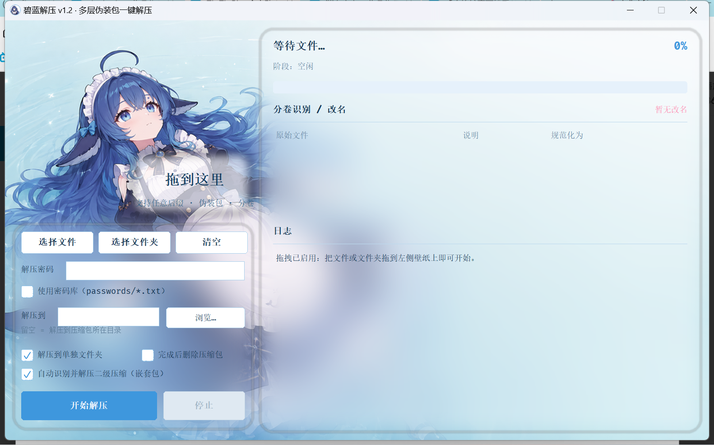

# 碧蓝解压（Blue Unzip）

> 多层伪装压缩包一键解压工具 · Windows 图形界面
> 把「改成任意后缀的压缩包」「改名过的分卷包」拖进来，一键解到最内层。


## 它能做什么

| 能力 | 说明 |
| --- | --- |
| **无视后缀识别** | 按文件头魔数判断格式，`.pdf` / `.jpg` 改成什么都照样认 |
| **分卷智能拼合** | 第一卷被改名、甚至全部卷都乱名，也能还原成 `.001 .002 …` 再解 |
| **多层嵌套递归** | 包里套包一直解到最内层，自动识别并重命名二级压缩包 |
| **加密包密码库** | 支持 `passwords/*.txt` 批量试密码，成功的密码自动记住 |
| **不碰原文件** | 分卷用「硬链接影子目录」拼合，不复制、不改名、不动原始压缩包 |
| **失败原因报告** | 解不开会说明为什么（密码错 / 包损坏 / 缺分卷…）并生成报告文件 |

## 界面



## 快速开始

1. 下载 Release 里的 `碧蓝解压_vX.X.zip`，解压到任意目录（**整个文件夹一起用**，别只拿 exe）。
2. 双击 `碧蓝解压.exe`。
3. 把文件或文件夹拖到左侧区域即可。

> 内置 `7z/` 是解压引擎，`assets/` 是主题素材与字体，缺一不可。

## 四个开关

- **解压到**：留空 = 压缩包所在目录，也可以指定输出目录
- **解压到单独文件夹**：默认开启，重名自动加序号
- **完成后删除压缩包**：成功且产出非空时才删，分卷整组删除
- **自动识别并解压二级压缩**：默认开启，关掉只解第一层

## 命令行版

```bat
碧蓝解压-命令行.exe [选项] 文件或文件夹 [更多路径…]

  --out DIR        解压到指定目录
  --no-separate    不再套一层同名文件夹
  --delete-source  成功后删除原始压缩包
  --no-recursive   只解第一层
```

## 从源码运行

```bat
py -m pip install pillow tkinterdnd2
py unzip_gui.py
```

打包（需要 PyInstaller）：

```bat
py -m PyInstaller --onefile --windowed --name 碧蓝解压 ^
  --icon assets/icon.ico --add-data "assets;assets" ^
  --collect-all tkinterdnd2 --collect-submodules PIL unzip_gui.py
```

## 项目结构

```
unzip_gui.py            图形界面（Canvas 自绘 + 私有字体 + DPI 感知）
unzip_core.py           解压引擎（识别 / 分卷拼合 / 递归 / 失败诊断）
complex-unzip-tool-mod.py   命令行入口
make_assets.py          主题素材生成（壁纸 / 图标）
assets/                 壁纸、图标、Fira Code 字体
7z/                     7-Zip 引擎
```

## 已知限制

- 仅 Windows 10 / 11 64 位
- 全部卷都被改成无规律乱名、且目录里混有无关同尺寸文件时，卷序可能推断失败（会报错跳过，不损坏文件）
- 分卷集合必须完整且同目录
- 只支持 7-Zip 能识别的格式

## 致谢与许可

- 代码基于 [Complex-Unzip-Tool](https://github.com/TR-Supowe/Complex-Unzip-Tool)（MIT）改造，保留原作者版权
- 界面字体 [Fira Code](https://github.com/tonsky/FiraCode)（SIL OFL 1.1）
- 解压引擎 [7-Zip](https://www.7-zip.org/)（LGPL）
- 插画素材来源 **ZipZipPipe**，版权归原作者所有，仅随本项目附带展示

本项目以 MIT 协议开源，详见 [LICENSE](LICENSE)。
